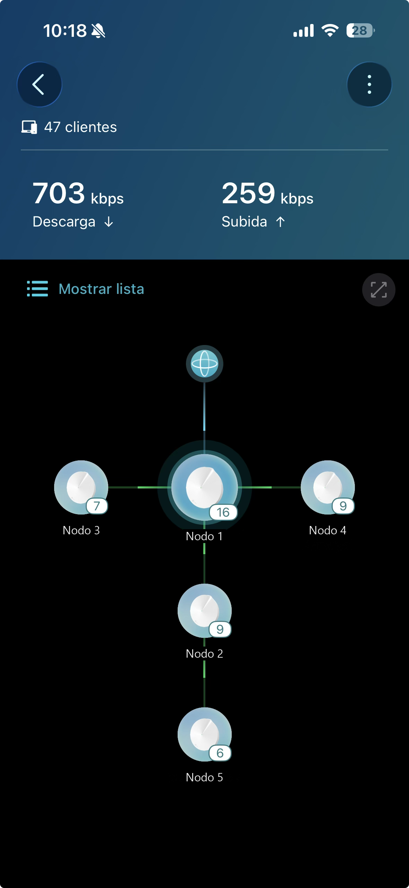
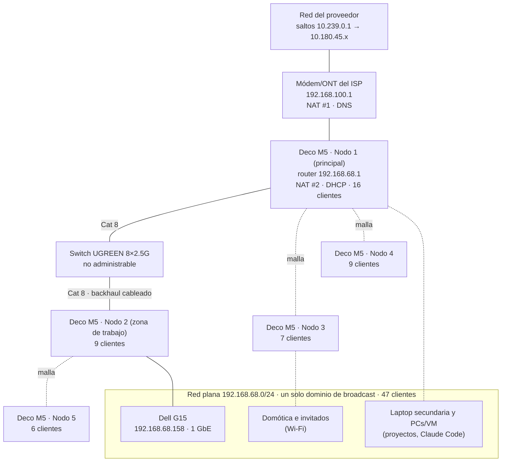

# 01 · Red actual del home office (caso de estudio)

Este documento describe la red **real** tal como opera hoy. Todo se obtuvo en modo
solo lectura (script `scripts/linea-base.ps1` y la app Deco): no se modificó ningún
equipo, porque la red está en producción (trabajo y domótica). La implementación del
proyecto se hace en un laboratorio emulado sobre este caso (ver `02-diseno.md`).

## 1. Contexto

- Home office desde el que se desarrollan **5 proyectos de software**.
- En los equipos de trabajo se usa **Claude Code**, un asistente de IA en la nube: el
  código y su contexto viajan por HTTPS hacia `api.anthropic.com`, fuera de la red local.
- La casa tiene domótica administrada sobre la misma red Wi-Fi.

## 2. Inventario físico

| Equipo | Función | Datos relevantes para la red |
|---|---|---|
| Módem/ONT del ISP | Acceso a internet, **NAT #1** | LAN 192.168.100.1; también sirve DNS a la casa |
| TP-Link Deco M5 · Nodo 1 (principal) | Router de la malla, **NAT #2**, DHCP | 192.168.68.1/24 · AC1300 · 2 puertos 1 GbE · 16 clientes |
| Deco M5 · Nodo 2 (zona de trabajo) | Nodo de malla | Backhaul **cableado** vía switch · 9 clientes |
| Deco M5 · Nodos 3, 4 y 5 | Nodos de malla | 7, 9 y 6 clientes |
| Switch UGREEN 8 × 2.5 GbE | Conmutación entre el Nodo 1 y el Nodo 2 | No administrable (supuesto: anuncio "Plug & Play", sin 802.1Q) |
| Cable UGREEN Cat 8, 3 m | Enlaces cableados | Especificado a 40 Gb/s, 2000 MHz |
| Dell G15 5511 (esta PC) | Estación de trabajo y futuro servidor del laboratorio | i7-11800H 8c/16t · 15.7 GB RAM · RTX 3060 Laptop **6 GB VRAM** · NIC Killer E2600 **1 GbE** · Windows 11 Pro · 192.168.68.158 (DHCP) |
| Laptop secundaria y otras PCs/VM | Equipos donde corren parte de los proyectos | En la misma red plana |

Total reportado por la app Deco: **47 clientes** (16 + 7 + 9 + 9 + 6).

## 3. Topología y direccionamiento actual

| Elemento | Valor | Fuente |
|---|---|---|
| Red de la casa | 192.168.68.0/24, gateway 192.168.68.1 (Deco) | `evidencia/dia1/interfaces.txt` |
| Red módem ↔ Deco | 192.168.100.0/24 | `traceroute.txt`, salto 2 |
| DNS entregado | 192.168.100.1 y 192.168.68.1 | `interfaces.txt` |
| IPv6 | Solo enlace local y **ULA** `fdb7:…/64` (sin IPv6 global), pero con ruta por defecto `::/0` vía el Deco | `interfaces.txt`, `ipv6.txt` |
| IP pública | 189.203.x.x (oculta). CGNAT no verificado; no afecta al laboratorio | `ip-publica.txt` |
| Vecinos vistos por ARP | 15 (solo los que hablaron recientemente con la Dell) | `vecinos-arp.txt` |

> El punto exacto de conexión de cada equipo (puerto del Deco o del switch) es
> ilustrativo en el diagrama; lo único verificado es que la Dell está cableada a 1 Gb/s.

## 4. Línea base medida (23-oct-2026, 20 muestras ICMP por destino)

| Destino | Latencia promedio | Máx. | Jitter (desv. est.) | Pérdida |
|---|---|---|---|---|
| Deco (gateway) 192.168.68.1 | < 1 ms (0.10 ms) | 1 ms | 0.30 ms | 0 % |
| Módem/ONT 192.168.100.1 | 1.15 ms | 2 ms | 0.36 ms | 0 % |
| Internet 8.8.8.8 | 12.70 ms | 15 ms | 0.84 ms | 0 % |

**Conexión a la IA en la nube** (`api.anthropic.com`, 5 muestras, `ia-nube.txt`):

| Modo | TCP establecido | TLS completo | Respuesta HTTP |
|---|---|---|---|
| Doble pila (por defecto) | ≈ 255 ms | ≈ 305 ms | ≈ 345 ms |
| Solo IPv4 (`curl -4`) | ≈ 50 ms | ≈ 100 ms | ≈ 140 ms |

## 5. Hallazgos (problemática)

1. **Red plana.** 47 clientes (equipos de trabajo, móviles, domótica, invitados)
   comparten un solo dominio de broadcast y una sola subred. Cualquier dispositivo
   IoT comprometido puede alcanzar los puertos de las PCs de trabajo.
2. **Sin control de acceso entre equipos.** El Deco M5 no ofrece VLAN configurables y
   todo equipo cableado queda en la red principal; el switch no es administrable.
3. **Sin acceso remoto seguro.** No hay VPN. Además hay **doble NAT** (ONT + Deco),
   lo que obliga a reenviar puertos dos veces para cualquier servicio entrante.
4. **Datos fuera de la red.** El uso de IA generativa depende de un servicio en la nube:
   el código de los 5 proyectos sale de la red y cada conexión nueva paga como mínimo
   ≈ 100 ms de establecimiento TCP + TLS.
5. **IPv6 "a medias" (agujero negro).** El Deco anuncia un prefijo ULA y además una
   **ruta por defecto IPv6**, pero el proveedor no entrega IPv6: una conexión TCP directa
   por IPv6 a `api.anthropic.com` agota el tiempo a los **≈ 21 s** sin recibir error
   (`ipv6.txt`). Los clientes de doble pila que priorizan IPv6, como curl, caen a IPv4
   tras ≈ 200 ms (Happy Eyeballs, RFC 8305): la conexión por defecto tarda **≈ 5 veces
   más** en establecer TCP que forzando IPv4. Una aplicación sin Happy Eyeballs se
   quedaría esperando el timeout completo.
6. **Cuello de botella de alta velocidad.** El switch (2.5 Gb/s) y el cable Cat 8
   (40 Gb/s) están subaprovechados: los puertos del Deco M5 y la NIC de la Dell son de
   1 Gb/s, así que el enlace efectivo extremo a extremo es de **1 Gb/s** por cable y
   menor por la malla Wi-Fi AC1300. Para aprovechar 2.5 Gb/s haría falta NIC de 2.5 GbE
   en ambos extremos y conectarlos al switch sin pasar por el Deco.

## 6. Por qué un laboratorio emulado

- La red está en producción (trabajo diario y domótica): no se interrumpe.
- El hardware disponible no soporta 802.1Q (Deco M5 y switch no administrable).
- La emulación permite un **experimento controlado**: la misma batería de pruebas se
  ejecuta sobre una topología plana (equivalente a la actual) y sobre la segmentada.
- La sección "Migración a hardware real" de `02-diseno.md` describe cómo llevar el
  diseño a VLAN físicas.
