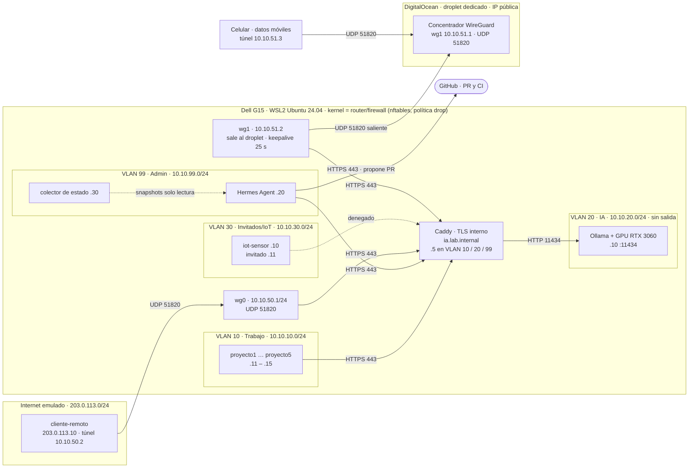

# 02 · Diseño de red objetivo

## 1. Enfoque

La red real (`01-red-actual.md`) es el **caso de estudio y la línea base**. El diseño se
implementa como **laboratorio emulado** dentro de la Dell G15 (WSL2 + Ubuntu 24.04 +
Docker Engine), sin tocar la red de la casa. El kernel Linux del laboratorio cumple el
papel de router/firewall entre segmentos.

Para validar el acceso remoto con un cliente real, un **droplet dedicado de DigitalOcean**
actúa como concentrador WireGuard: la Dell se conecta hacia afuera y el celular llega por
datos móviles, sin modificar la red de la casa. El droplet es solo un concentrador VPN,
no un servidor de aplicaciones.

Se construyen dos topologías con los mismos servicios para comparar:

| Topología | Equivale a | Características |
|---|---|---|
| **Plana** ("antes") | La red actual | Una sola red `10.10.0.0/24`, Ollama publicado en `:11434` para todos, sin TLS, sin VPN, sin reglas |
| **Segmentada** ("después") | El diseño propuesto | 4 segmentos + VPN, nftables con denegación por defecto, IA solo por Caddy `:443` con TLS |

## 2. Equivalencias VLAN ↔ laboratorio

Una VLAN es, en esencia, un dominio de broadcast separado con su propia subred y un
router que aplica política entre ellos. En un solo host eso se obtiene así:

| Concepto en red física | Implementación en el laboratorio |
|---|---|
| VLAN (dominio de broadcast) | Una red Docker tipo *bridge* por segmento (un bridge Linux = un dominio L2) |
| Puerto de acceso | Interfaz `veth` del contenedor conectada a su bridge |
| Router inter-VLAN / *router-on-a-stick* | Kernel del host con una interfaz en cada bridge (`ip_forward`) |
| ACL entre VLAN | Tabla `nftables` `inet netseg`, cadena `forward`, política *drop* |
| Segmento sin salida a internet | Red Docker `internal: true` (sin ruta por defecto ni NAT) |
| DHCP con reservas | IPAM estático de Docker (IP fija por servicio) |
| Concentrador VPN | Interfaz `wg0` (WireGuard) en el host |
| Internet | Red `inet-emulada` con un rango de documentación (RFC 5737) |

Limitación declarada: no hay etiquetado 802.1Q en el cable. El etiquetado real se
describe en la sección 9.

## 3. Plan de segmentos y direccionamiento

Supernet del laboratorio: **10.10.0.0/16**. Convención: el tercer octeto es el ID de VLAN
(fácil de leer y de resumir en rutas). No se traslapa con la casa (192.168.68.0/24),
con la red del módem (192.168.100.0/24), ni con las redes por defecto de Docker/WSL (172.16.0.0/12).

| VLAN | Segmento | Subred | Gateway | Salida a internet | Equipos (IP) |
|---|---|---|---|---|---|
| 10 | Trabajo | 10.10.10.0/24 | .1 (host) | Sí | `caddy` .5 · `proyecto1`–`proyecto5` .11–.15 |
| 20 | IA | 10.10.20.0/24 | ninguno (`internal`) | **No** | `caddy` .5 · `ollama` .10 |
| 30 | Invitados / IoT | 10.10.30.0/24 | .1 (host) | Sí | `iot-sensor` .10 · `invitado` .11 |
| 99 | Administración | 10.10.99.0/24 | .1 (host) | Solo TCP 443 | `caddy` .5 · `hermes` .20 · `colector` .30 |
| 50 | VPN emulada (`wg0`) | 10.10.50.0/24 | .1 (`wg0` en host) | No (túnel dividido) | `cliente-remoto` .2 |
| 51 | VPN real (`wg1`, vía droplet) | 10.10.51.0/24 | .1 (droplet) | No (túnel dividido) | droplet .1 · Dell .2 · celular .3 |
| — | Internet emulado | 203.0.113.0/24 | .1 (host = "IP pública" del servidor) | — | `cliente-remoto` 203.0.113.10 |
| — | Plana ("antes") | 10.10.0.0/24 | .1 (host) | Sí | Todos los servicios anteriores, con la misma numeración salvo `iot-sensor` .40 e `invitado` .41 (.10 y .11 ya son de `ollama` y `proyecto1`) |

`caddy` es el único equipo con pata en varios segmentos (10, 20 y 99): funciona como
**puerta de enlace de aplicación** hacia la IA. Ollama solo existe en el segmento 20.
Nombre del servicio: `ia.lab.internal` (TLD `.internal`, reservado para uso privado),
publicado como alias de `caddy` en cada red y como `10.10.50.1:443` y `10.10.51.2:443`
para las VPN (el certificado interno incluye esas IP, porque el celular no resuelve
nombres `.internal`).

## 4. Servicios y puertos

| Servicio | Segmento | Puerto | Expuesto a |
|---|---|---|---|
| Caddy (proxy inverso, TLS con CA interna) | 10, 20, 99 | 443/TCP | Trabajo, Admin y VPN |
| Ollama (API del LLM) | 20 | 11434/TCP | **Solo** Caddy |
| WireGuard emulado (`wg0`) | host | 51820/UDP | Internet emulado |
| WireGuard real (`wg1`, concentrador) | droplet | 51820/UDP | Internet (Dell y celular) |
| SSH del droplet | droplet | 22/TCP | Solo la IP de casa al arrancar; después solo por `wg1` |
| iperf3 (pruebas) | según prueba | 5201/TCP | Solo durante mediciones |
| Hermes Agent | 99 | sin puertos de entrada | Sale a Caddy :443 y a GitHub :443 |

## 5. Matriz de flujos (topología segmentada)

Política por defecto: **denegar**. Solo se permite lo que aparece con ✅. El tráfico de
respuesta se permite por estado (`ct state established,related`).

| Origen ↓ / Destino → | Trabajo | Ollama :11434 | Caddy :443 | Admin | Invitados/IoT | Internet |
|---|---|---|---|---|---|---|
| **Trabajo** | ✅ (mismo segmento) | ❌ | ✅ | ❌ | ❌ | ✅ (incluye IA en la nube) |
| **IA** | ❌ | — | (solo respuestas) | ❌ | ❌ | ❌ |
| **Admin** | ❌ | ❌ | ✅ | — | ❌ | ✅ solo TCP 443 |
| **Invitados/IoT** | ❌ | ❌ | ❌ | ❌ | ✅ (mismo segmento) | ✅ |
| **VPN emulada (`wg0`)** | ❌ | ❌ | ✅ vía 10.10.50.1:443 | ❌ | ❌ | ❌ |
| **VPN real (`wg1`)** | ❌ | ❌ | ✅ vía 10.10.51.2:443 | ❌ | ❌ | ❌ |
| **Internet emulado** | ❌ | ❌ | ❌ | ❌ | ❌ | — (solo UDP 51820 al host) |

Excepción temporal: durante el aprovisionamiento el modelo se descarga en la topología
plana (que sí tiene salida) sobre un volumen compartido; la topología segmentada monta
ese volumen y nunca necesita salida.

En el droplet, la cadena `forward` solo permite `wg1 → wg1` del celular (.3) a la Dell
(.2) por TCP 443; el resto se descarta. El Cloud Firewall de DigitalOcean repite la misma
política afuera del droplet (solo UDP 51820 de entrada, y SSH desde la IP de casa).

## 6. Diagrama lógico (topología segmentada)

El tráfico del celular hace un rodeo (celular → droplet en EE. UU. → casa): su latencia
es la suma de ambos tramos y se mide. Reenviar puertos en el router daría un camino
directo, pero obliga a modificar la red de la casa y a eliminar un NAT.

## 7. Decisiones de diseño (con justificación de red)

| # | Decisión | Justificación desde la red | Alternativa descartada |
|---|---|---|---|
| D1 | Laboratorio emulado sobre el caso real | No interrumpe una red en producción; el hardware no soporta 802.1Q; permite comparar plana vs segmentada con la misma batería de pruebas | Reconfigurar Deco/switch reales |
| D2 | WSL2 Ubuntu con Docker Engine (no Docker Desktop) | nftables, rutas y bridges viven en el mismo kernel que se administra con Ansible; GPU por CUDA en WSL | Docker Desktop: sus redes viven en otra VM no administrable |
| D3 | Un bridge por segmento + nftables con *drop* por defecto | Separa dominios de broadcast y aplica mínimo privilegio entre segmentos | Una sola red con listas de IPs (no separa L2) |
| D4 | Segmento IA `internal` sin salida | Los datos y prompts no pueden salir aunque un contenedor se comprometa | Solo reglas de salida (un error de regla abriría la fuga) |
| D5 | Caddy como única puerta hacia la IA, TLS con CA interna | Un solo punto de control (TLS, registro, token por proyecto); no requiere ACME ni salida a internet | Exponer Ollama `:11434` directo (sin cifrado ni control) |
| D6 | WireGuard en el host con túnel dividido | UDP con sobrecarga baja (MTU 1420); no responde a paquetes no autenticados, así que no se revela ante escaneos; solo enruta 10.10.50.0/24 y el resto del tráfico del cliente no pasa por el túnel | OpenVPN (más sobrecarga), túnel completo |
| D7 | Hermes en Admin, solo lectura, propone PR | Separación de funciones: la IA observa y propone; la red solo cambia por el pipeline con aprobación humana. El control efectivo es la protección de la rama `main` (PR + CI + aprobación obligatorios), no la buena conducta del agente | Darle shell al host (riesgo de cambios no auditados) |
| D8 | GitHub público + runner autohospedado en WSL | El runner solo abre conexiones salientes (funciona tras doble NAT/CGNAT); aprobación manual por *Environment* | Exponer SSH del servidor a internet |
| D9 | Modelo `qwen3.5:2b` (Q8_0, 1.9 B) con contexto de 64 K y caché KV f16 | Hermes exige ≥ 64 K de contexto. **La estimación original (`qwen2.5:3b`, ≈ 4.3 GB a 64 K) falló al medirla en el Día 3**: Ollama recorta el contexto al de entrenamiento del modelo (32 K en qwen2.5) por variable de entorno, por API y por Modelfile (`WARN requested context size too large for model`), así que hace falta un modelo entrenado con ≥ 64 K y de caché KV barata. `qwen3.5:2b` (262 K de entrenamiento, con herramientas) es híbrido: solo 6 de sus 24 capas llevan atención, y la caché ocupa **768 MiB a 64 K** (qwen2.5 habría necesitado ≈ 2.4 GB). El modelo entero ocupa **3.2 GB, 100 % GPU**, con ≈ 1.5 GB de holgura. Verificado con un prompt de 57 647 tokens con una "aguja" al inicio, recuperada (`evidencia/dia3/modelo-64k.txt`) | `qwen2.5:3b` (recorte a 32 K); `granite4.1:3b` (128 K, con herramientas, pero su caché f16 a 64 K lo lleva a 7.8 GB y 45 % en CPU: solo cabe con caché `q4_0`, 3.8 GB 100 % GPU; medido y reservado como alternativa); `qwen3.5:4b` (no se pudo descargar: `Error: EOF` en tres intentos); modelos de 7–8 B (desbordan a CPU) |
| D10 | Concentrador WireGuard en un droplet dedicado de DigitalOcean | La Dell abre la conexión hacia afuera (keepalive 25 s), así atraviesa el doble NAT sin reenviar puertos ni tocar la casa; IP pública fija; región elegida por latencia medida. El TLS de Caddy es extremo a extremo: el droplet solo descifra el salto WireGuard y ve tráfico TLS y metadatos. Dedicado para aislar fallas y reglas de otros proyectos | Reenviar puertos en ONT + Deco (modifica la red; posible CGNAT); Tailscale (plano de control de un tercero); reutilizar otro droplet; correr Ollama o Hermes en el droplet (los prompts saldrían de la red en texto claro, sin GPU, +latencia WAN en cada petición y API expuesta en internet) |
| D11 | La política entre segmentos vive en una tabla `nftables` propia que debe cumplir la matriz **sin depender de Docker**; las reglas de Docker quedan como respaldo (backend `iptables`) | Docker ya aísla bridges y protege la IP de cada contenedor (`raw/PREROUTING`), pero eso no lo controla el proyecto ni existe en un router real (§9). Medido en el Día 2: Docker solo falla 2 de 35 casos (Ollama iniciando conexiones y la salida de Admin por TCP 80), y con sus reglas DROP retiradas `netseg` sola detiene los 14 flujos bloqueados que llegan al filtrado (35/35; otros 9 no tienen ruta de salida por D4). Orden de evaluación: `raw` −300 → `netseg` −10 → `filter` de Docker 0 | `--firewall-backend nftables` de Docker (opción nueva del daemon: la política seguiría mezclada con reglas ajenas); `--iptables=false` (obliga a reescribir NAT y publicación de puertos a mano) |

## 8. Plan de pruebas y métricas (se aplica a ambas topologías)

| Prueba | Herramienta | Qué demuestra |
|---|---|---|
| Matriz de alcanzabilidad | `nc -zv`, `curl` desde cada segmento | Que la política de la sección 5 se cumple (y que en la plana todo está abierto) |
| Latencia ICMP intra e inter-segmento | `ping -c 50` | Costo de enrutar/filtrar en el host |
| Latencia de la API | `curl -w` (TCP, TLS, primer token, total) | Directo a Ollama vs Caddy TLS vs VPN; comparación con la nube (`01-red-actual.md` §4) |
| Throughput | `iperf3` (TCP, 10 s, 3 repeticiones) | Capacidad entre segmentos y sobrecarga de WireGuard |
| VPN | `wg show`, handshake, `ping`/`iperf3` por el túnel | Acceso remoto cifrado funcionando |
| Ubicación del concentrador | `ping -c 50` desde casa a droplets de prueba en 2–3 regiones (minutos, luego se destruyen) | Región elegida por datos, no por suposición |
| VPN real por internet | `ping`/`iperf3` droplet ↔ Dell por `wg1`; HTTPS desde el celular | Latencia y throughput WAN reales, incluido el rodeo por el droplet |
| Contexto/VRAM | `ollama ps`, `nvidia-smi` | Modelo 100 % en GPU con contexto de 64 K |
| Opcional (real) | `iperf3` Dell ↔ laptop secundaria por el switch | Cuello de botella físico de 1 Gb/s |

**QoS.** El tráfico de la API es de bajo volumen (texto, kb/s) pero sensible a latencia
(*streaming* de tokens); el tráfico masivo (descarga de modelos, GB) ocurre solo en la
ventana de aprovisionamiento. Por eso basta con separar en el tiempo y, si sobra tiempo,
aplicar `fq_codel` en `wg0` y medir latencia bajo carga. En hardware real: marcar DSCP
AF41 para la API.

## 9. Migración a hardware real (VLAN 802.1Q)

Con un switch administrable (que reemplace al UGREEN) y un router/firewall con VLAN
(OPNsense u OpenWrt en un mini PC), con los Deco en **modo AP**:

| Puerto del switch | Conecta a | Modo | VLAN |
|---|---|---|---|
| 1 | Router/firewall | Troncal | 10, 20, 30, 99 (etiquetadas) |
| 2 | Deco Nodo 1 (modo AP) — toda la malla Wi-Fi y la domótica | Acceso | 30 |
| 3 | Servidor de IA (Dell) | Troncal | 10, 20, 99 (subinterfaces 802.1Q) |
| 4 | Laptop secundaria | Acceso | 10 |
| 5–6 | PCs de proyectos | Acceso | 10 |
| 7 | Equipo de administración | Acceso | 99 |
| 8 | Deco Nodo 2 (modo AP, backhaul cableado) | Acceso | 30 |

La Dell se recablea directo al switch (puerto 3) en lugar de colgar del Deco Nodo 2.

- El router aplica la misma matriz de la sección 5 entre subinterfaces y termina
  WireGuard en su IP pública (requiere quitar un NAT: Deco en modo AP elimina el NAT #2).
- El Deco M5 no etiqueta SSID; por eso toda la malla va a la VLAN 30. Los equipos de
  trabajo deben ir cableados (VLAN 10), o bien reemplazar los AP por modelos con SSID por VLAN.
- El repositorio no cambia de forma: el mismo Ansible genera las reglas para el router
  real en lugar del host del laboratorio.

## 10. Riesgos

| Riesgo | Mitigación |
|---|---|
| 6 GB de VRAM no alcanzan para modelo + contexto 64 K | Resuelto en el Día 3 (D9): modelo híbrido de caché pequeña, 3.2 GB 100 % GPU; si hiciera falta más holgura, `OLLAMA_KV_CACHE_TYPE=q8_0` |
| La memoria de Windows se agota al cargar el modelo (el límite de commit, no la RAM) | Observado en el Día 3: cargar el modelo cuesta ≈ 3.7 GB de commit y WSL se cayó una vez. Mitigación: `LLAMA_ARG_CACHE_RAM=1024`, `OLLAMA_KEEP_ALIVE=5m` y liberar la caché de la VM tras descargas; ver `03-laboratorio.md` §7.5 |
| Disco: 34 GB libres en C: | Requerido ≈ 12–15 GB; liberar espacio antes del Día 2 |
| Reglas de Docker interfieren con nftables propias | Tabla propia con prioridad anterior a la de Docker; se valida con la matriz de alcanzabilidad. Verificado en el Día 2: ver D11 y `03-laboratorio.md` §4 |
| El droplet queda expuesto a internet | SSH solo con llave y, tras arrancar, solo por `wg1`; Cloud Firewall + nftables con denegación por defecto; WireGuard no responde a paquetes no autenticados |
| El droplet tiene costo mensual | Tamaño mínimo; se destruye al terminar (el despliegue con Ansible lo recrea) |
| Hermes ejecuta comandos sin aprobación en backend Docker | No tiene acceso al host: solo lee snapshots montados en modo lectura; sus cambios son PR |
